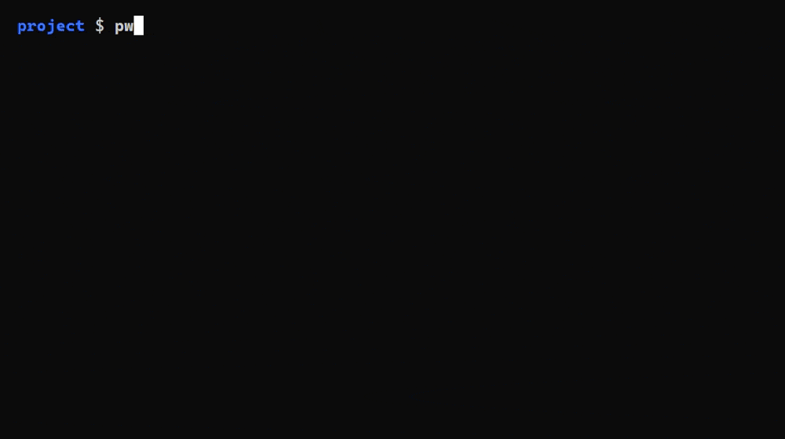
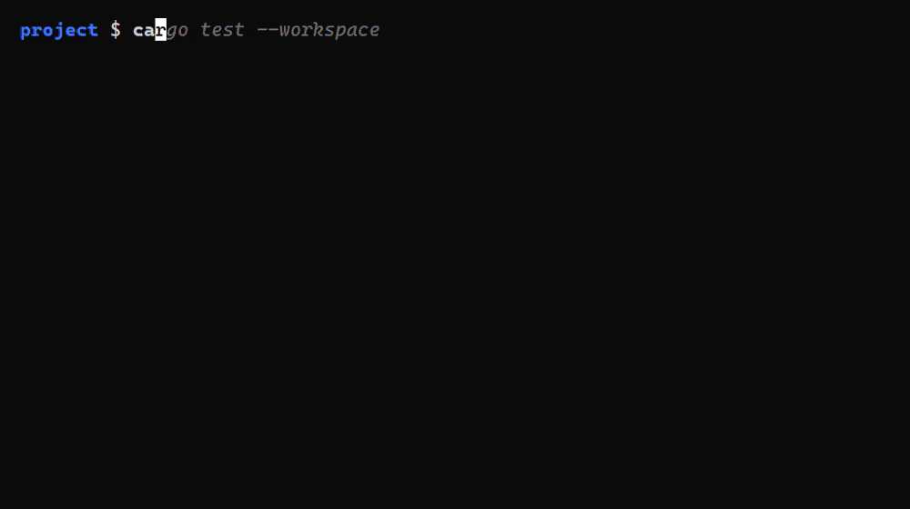
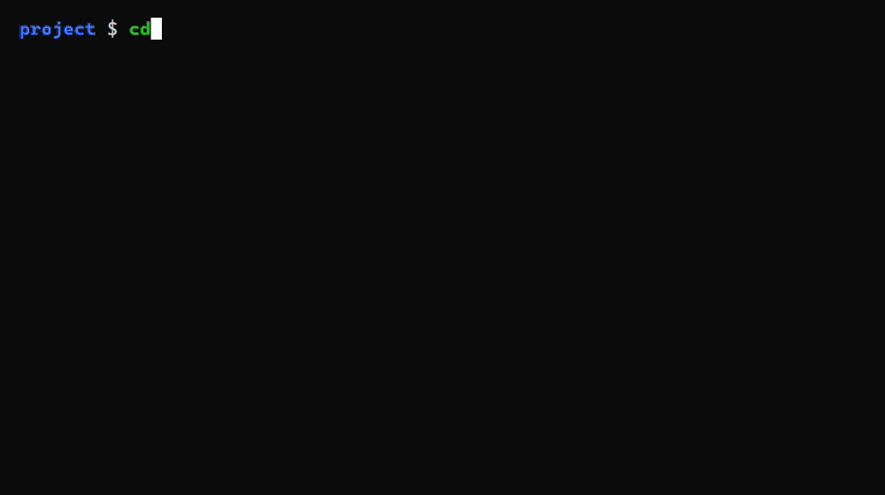
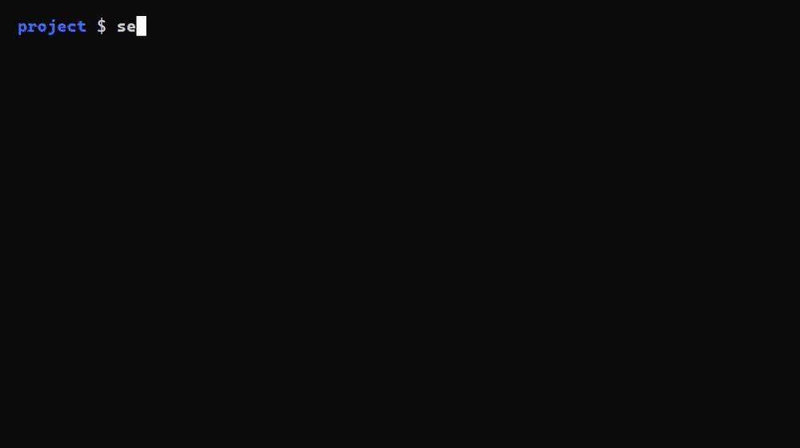

# cash - Cool Again SHell


[](https://github.com/tomcoolpxl/cash/actions/workflows/ci.yml)
[](https://github.com/tomcoolpxl/cash/releases)
[](LICENSE)

A bash-language shell whose execution model is **Win32**, hosted in Windows Terminal.
No POSIX emulation layer, no VM, no `msys-2.0.dll` underneath: the processes, paths and
handles are native, and the scripts are ordinary bash.

It runs Terraform wrappers, CI glue and pipelines with `xargs`, `sed`, `grep` and `jq`
unchanged, and it carries the tools a bare Windows machine lacks, so that installing cash
gives a complete Bash: the coreutils, `awk`, `sed`, `grep`, `diff`, `find`, `xargs`,
`tar`, `zip`, `7z`, `rar`, `gzip`, `xz`, `zstd`, `top`, `lsof`, `ss`, and about 250 in all.

## See it

<table>
  <tr>
    <td align="center" width="50%"><b>Paths</b>: <code>C:\</code>, <code>C:/</code> and <code>/c/</code> all work, <code>pwd</code> prints one spelling<br>
      </td>
    <td align="center" width="50%"><b>A bash script</b>, nothing installed: <code>find</code>, <code>xargs</code>, <code>grep</code>, <code>sed</code>, <code>awk</code> are inside <code>cash.exe</code><br>
      </td>
  </tr>
  <tr>
    <td align="center"><b>The prompt</b>: highlighting, a command that does not exist turns red, suggestions from history, Ctrl-R<br>
      </td>
    <td align="center"><b>Directories</b>: Alt-← and Alt-→ step through where you have been, <code>z</code> jumps, Alt-E picks<br>
      </td>
  </tr>
  <tr>
    <td align="center"><b>Jobs</b>: Ctrl-Z stops a program, <code>bg</code> and <code>fg</code> resume it, Ctrl-C gives 130, <code>kill %1</code> ends a job<br>
      </td>
    <td align="center"><b>Who holds this port, who holds this file</b>: <code>ss</code>, <code>lsof</code>, <code>fuser -k</code><br>
      </td>
  </tr>
  <tr>
    <td align="center"><b>top</b>, procps style, with meters, sorting and a process tree<br>
      </td>
    <td align="center"><b>The archivers</b>: <code>tar</code>, <code>zip</code>, <code>7z</code> and <code>rar</code>, built in<br>
      </td>
  </tr>
  <tr>
    <td align="center"><b>Help</b>: <code>man</code> is a browser, <code>help</code> prints, a missing command names its package<br>
      </td>
    <!-- sextant.gif is recorded by hand (assets/demos/README.md); once it is there:
    <td align="center"><b>sextant</b>, a shooter drawn with text, because a shell should have one<br>
      </td>
    -->
  </tr>
</table>

The clips are rendered from the tapes in [assets/demos](assets/demos) with
[VHS](https://github.com/charmbracelet/vhs). `sextant`, the shooter drawn with text, is
not among them: its font is one cash sends the terminal, which only Windows Terminal
draws, so its clip is a screen recording.

## Install

With [Scoop](https://scoop.sh), as a normal user, without admin:

```bash
scoop bucket add tomcoolpxl https://github.com/tomcoolpxl/scoop-bucket
scoop install cash
```

Scoop puts `cash` on PATH and Windows Terminal lists a `cash` profile from its next
start. Without Scoop, the setup on the [releases
page](https://github.com/tomcoolpxl/cash/releases) (`cash-vX.Y.Z-setup.exe`) installs
cash for your account alone, without admin, with the Terminal profile, `cash` on PATH
and, ticked by default, the bundled tools as programs on PATH too (`ls.exe`, `sed.exe`,
`awk.exe`, ...), so that editors, `make` and scripts outside cash find them. For scripts
and winget: `cash-vX.Y.Z-setup.exe /VERYSILENT /SUPPRESSMSGBOXES /NORESTART`. Upgrade
with `cash --update`.

**Portable**: unpack the release zip anywhere and run `cash.exe`. That one file is the
whole shell: the C runtime is linked in, and every tool and help page is inside it. At its
first prompt it offers once to put itself on PATH and to add the Terminal profile; Enter
means no.

If you have neither a `~/.bashrc` nor a `~/.cashrc`, the first install writes a starter
`~/.bashrc`, read by cash and by Git Bash: a prompt with the directory and git branch, a
large shared history, the usual aliases and `ls` with icons. `cash help installing` has
every detail, the install's optional steps among them.

## Why bother

Windows already has Git Bash, MSYS2, WSL and Cygwin. They work by making Windows pretend
to be Unix. cash starts from the other end: keep the bash language, and make the
execution model native Windows.

In numbers:

- Compatibility: ~900 scripts from ~50 projects give the same output as in Git Bash 5.3.
- Tools: ~250 commands built in, among them tar, zip, 7z, rar, gzip, bzip2, xz and zstd,
  all without anything else installed.
- Tests: 9,000+ run on every release.

cash reports Bash 5.3 through `$BASH_VERSION`: every Bash 5.3 change is implemented,
checked against Git Bash 5.3, or documented as a deliberate difference. `cash help
differences` lists where it knowingly differs from Bash and why, and
[docs/compatibility.md](docs/compatibility.md) has the audits behind that.

## What is different

The full reasoning is in [docs/spec.md](docs/spec.md); the short version:

| | |
| --- | --- |
| **Paths** | `C:/foo` is canonical. `C:\foo`, `/c/foo`, `/tmp` and `/dev/null` are all accepted; `pwd` always prints `C:/foo`. `shopt -s unixpaths` spells paths as Git Bash does, for the scripts that need it. |
| **Arguments** | Never rewritten. cash never guesses which argv entries are paths, which is where MSYS2 needs `MSYS2_ARG_CONV_EXCL`. |
| **`PATH`** | The one translated variable: `:`-separated for scripts, `;`-separated for children. |
| **Jobs and signals** | Every pipeline and background job runs in a Windows job object of its own: `kill %1` ends the whole tree, Ctrl-Z suspends, `fg` and `bg` resume, and nothing cash starts outlives cash being killed. |
| **Ctrl-C** | Escalates. The grace period is the *second* Ctrl-C, not a timer, because `terraform apply` can legitimately take minutes to stop cleanly, and killing it holds the state lock. |
| **CRLF** | `\r\n` terminates a line wherever cash interprets line boundaries. Pipes between external programs stay byte-transparent. |
| **Exit codes** | Truncate like bash, except crashes map to `128 + n`: an access violation is `139`, just like a segfault. Naive truncation would report `0xC0000100` as success. |
| **Robustness** | Release builds unwind panics. An unexpected panic while processing an interactive command is reported, sets status 1, and returns to the prompt; startup and non-interactive panics stop safely with status 1 instead of aborting the process. |

`sh` and `bash` resolve to cash itself, ahead of `PATH`. The alternative on Windows is
`C:\WINDOWS\system32\bash.exe`, the WSL launcher: without this, a script running `bash
helper.sh` would silently continue under Linux.

## At the prompt

The prompt borrows what fish does well, without giving up Bash's language:

- **Syntax highlighting** is on: keywords, strings, variables and options are coloured,
  and a command that does not exist turns red before Enter, in every part of a pipeline.
  Whether it exists comes from a background listing of `PATH`, so typing never waits on
  the disk.
- **Suggestions from history** appear dimmed as you type; → accepts one.
- **A history picker**: Ctrl-R lists the history below the line, each command once,
  newest first; typing filters it, Enter puts the command on the line and Tab runs it.
  Ctrl-R again shows what ran in the current directory.
- **Alt-.** inserts the previous command's last argument, and **Ctrl-X Ctrl-E** opens the
  line in `$VISUAL`/`$EDITOR` and runs what you save, as in Bash.
- **Abbreviations**: `abbr -a gco git checkout`, and `gco` becomes `git checkout` on the
  line when you press Space or Enter, so history keeps the full command. The options are
  fish's.
- **A collapsing prompt**: set `CASH_TRANSIENT_PS1` (it takes PS1's escapes) and a
  command's prompt shrinks to it once the line is entered, so scrollback shows commands,
  not status blocks. With Starship:
  `CASH_TRANSIENT_PS1='$(starship module character --status="$STARSHIP_CMD_STATUS")'`.
- **Directory history**: on an empty line, Alt-← and Alt-→ step back and forward through
  the directories you have been in; `prevd`, `nextd` and `cdh` do it by name.
- **A directory jump**: `z cash` goes to the directory matching `cash` you go to most,
  ranked across sessions as zoxide ranks them; `z -i` picks from a list and Tab after `z`
  offers the matches.
- **croot, a file and directory picker**: Alt-E opens a tree below the command line.
  Typing filters it, the arrows walk it, and Enter picks: on an empty line or after `cd`
  it goes there, after any other command it inserts the path. `croot` does the same from
  scripts (`cd "$(croot)"`).
- **Completions with descriptions** for 700+ commands, git, winget, docker, kubectl,
  terraform, cargo and npm among them, when
  [carapace](https://github.com/carapace-sh/carapace-bin) is installed
  (`scoop install extras/carapace-bin`). Without it, git still completes as in Git Bash,
  with Git for Windows' own completion script.

`cash help keys` lists every key.

## Help

`help` lists every builtin by kind, each with a line about it, and marks the ones that
hide a Windows program of the same name (`find`, `sort`, `more`, `timeout`, ...). `man`
opens the same pages in a full-screen browser; `cash help` says the same from PowerShell
or cmd.

```bash
cash help sed               # a builtin's page: Windows notes, then its own options
cash help topics            # paths, crlf, elevation, job-control, keys, config, vars, ...
cash help differences       # where cash knowingly differs from Bash, and why
cash help search CRLF       # every page and topic that mentions it
man sed                     # the page in a browser; links, search, the arrows
```

A command typed at the prompt that is not installed gets the package to install it with,
`install it: winget install jqlang.jq, or scoop install jq`, for the tools people miss most.
Run `cash doctor` to see what this machine has: it reports what cash would run, names
missing tools, BusyBox applets masquerading as fuller implementations, DOS `find` and
`sort` winning over the Unix ones, and Store aliases whose app is not installed.

## Userland

cash carries the whole of uutils coreutils, plus a set written for Windows because the
name resolves to something worse there: `find` and `xargs`, `ps`, `pgrep`, `pstree`,
`tree` and `top`, `less` and `more`, `which`, `where`, `chmod`, `hostname`, and
`coolfetch`.

The first rule for what cash carries was **does the tool have to agree with cash about
something cash owns?** `find` prints paths, so it owes cash one spelling; `xargs` builds
command lines, which on Windows are strings the callee re-splits; `ps` and `top` print
pids that `kill` must accept. Since the installer, the aim is wider: install cash and
have a complete Bash, so the tools a bare machine misses most, `grep`, `diff` and the
archivers, are carried too.

- **`awk` and `sed`** are native, and keep Windows files intact: a CRLF line is matched
  without its CR, so `$` works, and is written back as CRLF. A program that names `\r`
  (`sed 's/\r$//'`) sees the real line, and `CASH_EOL=lf` (or `sed -b`) gives Linux
  behaviour everywhere. `dos2unix` and `unix2dos` convert files between the two.
- **`grep`, `diff` and `cmp`**: `grep` with GNU grep's options, messages and exit codes on
  ripgrep's engine, its patterns read by the same translator as the bundled `sed`, so the
  two agree; `diff` and `cmp` from uutils diffutils, checked byte for byte against GNU's.
- **The archivers**: `tar`, `zip`, `unzip`, `7z`, `rar`, `unrar`, `gzip`, `bzip2`, `xz`
  and `zstd`, in pure Rust, with the originals' options.
- **Processes**: pids are Windows' own, so `ps -ef`, `pgrep`, `pstree -p` and `top` give
  numbers `kill` accepts. `top` is the procps overview with meters as in htop: `P`, `M`,
  `T` and `N` sort, `V` shows the tree, `k` sends a signal, `q` quits.
- **Who holds what**: `fuser` and `lsof` answer "who holds this file" and "who owns this
  port" from the Restart Manager and the socket tables: `fuser -k file.txt`, `kill
  $(lsof -t -i:8080)` and `lsof +D build/` work, and `lsof -p PID` lists what a process
  holds open, as Sysinternals' handle.exe does. `ss -tulpn`, `ss -ltn` and `ss -tn state
  established` print iproute2's layout, so port-wait loops written for Linux work
  unchanged.
- **`ls`** takes what lsd adds to it: `ls --icons` puts a Nerd Font glyph before each name
  when Windows Terminal draws the tab in a Nerd Font, `--tree` draws directories as a
  tree, names are coloured by kind and extension, and `ls -l` colours every column.
  `--attributes` adds Windows' `darhs` letters.
- **The console and the clipboard**: `tput`, `stty`, `iconv`, `column`, `xxd`, `hexdump`,
  `uuidgen`, `xdg-open`, `pbcopy` and `pbpaste`, `watch`, `free`, `nice` and `renice`,
  `flock` and `nc`, each checked against its Linux original where one exists.
- **`sudo`** elevates in this terminal, with the command's output here and its status
  back, through UAC and nothing else; `sudo -u USER` runs as another account. `cash help
  elevation` says what escapes cash's job and why.
- **`figlet`** prints text in big letters, as FIGlet 2.2.5 does, from FIGlet's and
  TOIlet's fonts, 23 of them built in. **`sextant`** is a game: a shooter drawn in the
  terminal with text, in full colour, from a soft font cash sends the terminal.
- **`where`** is Windows' `where.exe` with options spelled with dashes, printing paths as
  `C:/…`, like everything else cash prints.

Inside cash, `which ls` prints `C:/…/cash.exe/ls`, a path only cash can run. For programs
outside cash (Python's `subprocess`, a `.bat` file, an editor), `cash --link-tools`
makes a hard link to `cash.exe` for each tool, `ls.exe`, `sort.exe` and so on; the
installer does it by default, and `cash --unlink-tools` takes them away again.

A Git for Windows or Microsoft Coreutils copy of a tool on `PATH` stays reachable by its
path, and `type -a grep` lists it. Explicit executable paths bypass builtins.

## Windows Terminal

`cash --terminal-profile`, which the installs run for you, adds a `cash` profile with the
logo and command marks on: each command gets a mark on the scrollbar, green or red by its
exit status, and Ctrl+↑ and Ctrl+↓ jump between them. The profile asks for a Nerd Font
when the machine has one, so that `ls --icons` draws its file icons. To make it the
default, or give it a font and colours, add an entry with its GUID to Windows Terminal's
`settings.json` holding only your own settings; the program and icon keep coming from the
install, so upgrades need nothing.
[docs/windows-terminal.md](docs/windows-terminal.md) has that entry, the key bindings for
the marks, and the prompt sequences that make them work in any `~/.bashrc`.

## Building and contributing

[CONTRIBUTING.md](CONTRIBUTING.md) has the build, the tests and the layout of the
workspace. The shell language crates are **absorbed from
[brush](https://github.com/reubeno/brush)** and modified; `sed`, `awk` and `bc` from
uutils and posixutils-rs; see [NOTICE](NOTICE) for attribution and the list of changes.
Nothing is upstreamed: the trade is a coherent codebase instead of a patched copy of
someone else's, at the cost of porting future upstream improvements by hand.

The project's records are in [docs](docs): the [spec](docs/spec.md) with every decision
and its reasoning, the [decisions](docs/decisions.md) by topic, the
[roadmap](docs/ROADMAP.md), and what was [done](docs/DONE.md) in which release. What
is still open is in [TODO.md](TODO.md).

## Licence

MIT. Vendored brush is MIT, © Reuben Olinsky. The licences of the other absorbed code
are in [licenses](licenses) and [NOTICE](NOTICE).
