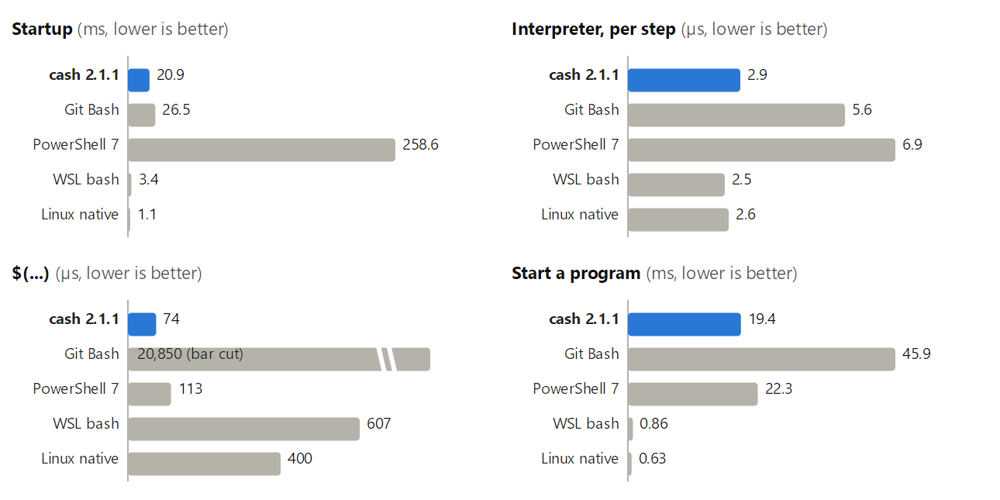

# Benchmarks at 2.1.1, against Git Bash, PowerShell, WSL and native Linux

The question (the user, 2026-10-23): the shell benchmark after the interpreter's speed work
(D86), on Windows and on the same machine booted into Linux, then a short version of the
table, and four charts. Kept to come back to.

## Method

`tests/shell-bench` on one machine (Ryzen 7 3700X, 32 GB): cash 2.1.1 (`dist`), Git Bash
5.3.15, PowerShell 7.6.6 and bash 5.3.20 in WSL2 (Arch) under Windows 11
(`tests/shell-bench/results/2026-10-23-2022-windows`), and bash 5.3.15 on Manjaro booted
natively (`results/2026-10-23-linux`). hyperfine's median of at least ten runs; one step's
cost with the shell's start taken off. `python tests/shell-bench/table.py` prints the full
table.

The short table puts each kind of cost on one line. **Interpreter** is the geometric mean
of the empty loop, `echo`, arithmetic, expansions and function calls. **Start a program**
is the one process workload every shell does the same way (`hostname.exe` on Windows,
`/bin/true` on Linux); the pipe and `ls -la` rows are left out of it, as PowerShell does
neither in a process of its own (`Out-Null`, `Get-ChildItem`), and averaging them in made
cash look slower than PowerShell at starting processes, which it is not.

| | cash 2.1.1 | Git Bash | PowerShell 7 | WSL bash | Linux native |
|---|---|---|---|---|---|
| **Startup** (ms) | 20.9 | 26.5 | 258.6 | 3.4 | 1.1 |
| **Interpreter**, per step (µs) | 2.9 | 5.6 | 6.9 | 2.5 | 2.6 |
| **`$(...)`** (µs) | 74 | 20,850 | 113 | 607 | 400 |
| **Start a program** (ms) | 19.4 | 45.9 | 22.3 | 0.86 | 0.63 |

Each chart has its own scale from zero; they are not to be compared with each other.
Git Bash's `$(...)` bar is cut (about 30 times the next). `benchmarks-2.1.1/charts.py`
draws them (`python charts.py out.svg`, then ImageMagick for the PNG).

## What it says

- cash is within about 10% of native Linux bash on interpreter work, level on `echo` and
  arithmetic, behind on expansions (6.7 against 4.9 us) and function calls (3.4 against
  2.9 us).
- `$(...)` is fastest in cash of the five: it runs in the shell's own process, where
  bash forks.
- What starts a process costs 15 to 30 times what it costs on Linux, Windows' price for
  a process, which every Windows shell pays; cash pays it once, Git Bash's Cygwin twice.
